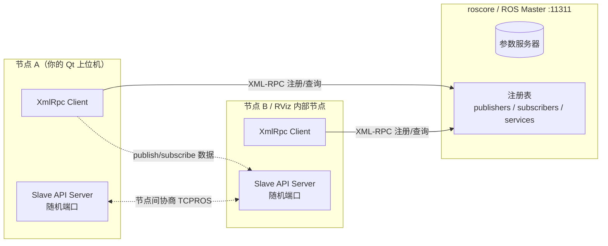
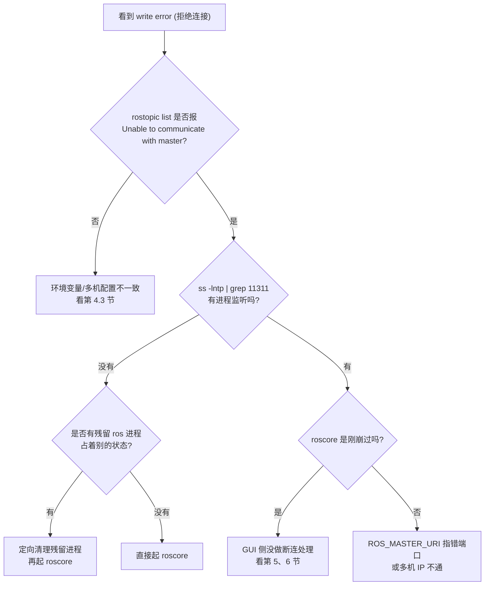

# 从刷屏报错到彻底根治：ROS1 `XmlRpcClient::writeRequest: write error (拒绝连接)` 全解析

> **关键词**：ROS1 · roscore · XmlRpc · 11311 · Qt5 · 内嵌 RViz · 优雅退出
>
> **适用版本**：Ubuntu 18.04 + ROS Melodic + Qt5.9 ｜ Ubuntu 20.04 + ROS Noetic + Qt5.15 + librviz
>
> **一句话结论**：这不是网络问题，也不是 Qt 的锅 —— 是你的 **ROS 节点（XmlRpc Client）连不上 ROS Master（roscore，11311 端口）**。`couldn't find source iterator` 只是 XmlRpc 内部的连带异常。


---

## 目录

- [0. TL;DR](#0-tldr)
- [1. 报错长什么样](#1-报错长什么样)
- [2. 这条日志到底在说什么](#2-这条日志到底在说什么)
- [3. 五分钟定位流程](#3-五分钟定位流程)
- [4. 五种高频原因逐个拆](#4-五种高频原因逐个拆)
- [5. Qt + 内嵌 RViz 的三个专属坑](#5-qt--内嵌-rviz-的三个专属坑)
- [6. 生产可用封装（完整代码）](#6-生产可用封装完整代码)
- [7. 日志降噪的正确姿势](#7-日志降噪的正确姿势)
- [8. Checklist 速查表](#8-checklist-速查表)
- [9. 最小复现实验](#9-最小复现实验)
- [10. 参考](#10-参考)

---

## 0. TL;DR

| 你看到的现象 | 真正的原因 | 处理动作 |
|---|---|---|
| `write error (拒绝连接)` 循环刷屏 | 11311 端口没人监听 / 连不上 | 起 `roscore`，或修 `ROS_MASTER_URI` |
| 关掉 roscore 后 GUI 还在刷 | Qt 里 ROS 线程没退出，一直在重试注册 | `closeEvent` 里 shutdown + join |
| `rostopic list` 报 `Unable to communicate with master!` | 同一件事 | 同上 |
| `couldn't find source iterator` | 连接被拒后 XmlRpc 内部 socket 表查找失败 | 忽略，治好上面那条它自己会消失 |
| 程序先起、roscore 后起 | 首次注册失败，节点陷入无休止重试 | **固定启动顺序**：roscore 稳了再起 GUI |

**先记这三条命令**：

```bash
rostopic list                              # 能连上 master 吗
echo $ROS_MASTER_URI                       # 地址对吗
ss -lntp | grep 11311                       # 端口有人听吗、谁在听
```

---

## 1. 报错长什么样

终端里通常是三行一组，无限循环：

```text
Error in XmlRpcClient::writeRequest: write error (拒绝连接).
Error in XmlRpcDispatch::work: couldn't find source iterator
Error in XmlRpcClient::writeRequest: write error (拒绝连接).
Error in XmlRpcDispatch::work: couldn't find source iterator
Error in XmlRpcClient::writeRequest: write error (拒绝连接).
Error in XmlRpcDispatch::work: couldn't find source iterator
```

注意几个细节：

- 报错前缀是 `Error in ...`，不是 rosconsole 的 `[ERROR] [时间戳]` 格式 —— 它来自 **xmlrpcpp / XmlRpc++** 这层 C++ 库，不是你的业务代码。
- `(拒绝连接)` 是 `strerror(errno)` 的中文输出，即 **ECONNREFUSED**：TCP 握手直接被 RST。
  - 如果是**超时 / 不可达**，会显示 `Connection timed out`、`No route to host`、`Network is unreachable` —— 那才是"网络问题"。
  - **`拒绝连接` 意味着：IP 到了，端口没人监听。** 99% 是本机 roscore 没起来 / 已经死了。
- 刷屏频率很高（每秒数次），因为它发生在 ROS 内部的重试路径上，不是你的 `while` 循环。

---

## 2. 这条日志到底在说什么

### 2.1 ROS1 是 Master–Slave 架构

ROS1 没有中心数据总线，只有**一个中心注册表 + N 个点对点节点**：



- **Master 的端口**就是 `ROS_MASTER_URI` 里的端口，默认 `11311`。
- 节点启动时要向 Master 发一堆 XML-RPC 请求：`registerPublisher`、`registerSubscriber`、`registerService`、`lookupNode`、`getParam`……
- 这些请求由 `ros_comm` 里的 **xmlrpcpp**（XmlRpc++ 的 ROS 分支）发出，也就是 `XmlRpcClient`。
- 节点自己还会开一个 **Slave API Server**（随机端口），供 Master 反向查询。

所以：**只要 Master 不可达，任何一次注册/查询都会在 `XmlRpcClient::writeRequest` 里写 socket 失败**，然后把错误打出来。

### 2.2 `couldn't find source iterator` 是"附带伤害"

`XmlRpcDispatch` 内部维护 `socket → 事件迭代器` 的映射表。连接被拒绝后 socket 被关闭并从表中移除，而挂起的写事件仍然持有旧迭代器，`work()` 这一轮去查表就查不到了，于是打印：

```text
Error in XmlRpcDispatch::work: couldn't find source iterator
```

**它是结果，不是原因。** 只要第一条消失，第二条自动消失。网上让你去改 xmlrpcpp 源码屏蔽它的方案，属于治标都算不上。

### 2.3 为什么它"停不下来"

这是 ROS1 的一个设计特点，也是最容易踩坑的地方：

> `ros::ok()` 只在**本进程调用 `ros::shutdown()` 或收到 SIGINT** 时变 false。
> **Master 挂了，`ros::ok()` 依然是 true。**

于是你的节点"看起来还活着"，内部却一直在重试注册 → 无限刷屏。GUI 程序尤其明显：窗口还在、按钮还能点，用户完全不知道后端已经废了。

---

## 3. 五分钟定位流程



### Step 1：Master 活着吗

```bash
rostopic list
```

- 正常：列出话题（哪怕是空的）。
- 异常：`ERROR: Unable to communicate with master!` → **确认是 Master 侧的问题**，继续往下。
- 卡住 3 秒再报错：正常的 XML-RPC 超时，说明地址可达但没人应答。

### Step 2：端口有没有人听

```bash
ss -lntp | grep 11311
# 或
lsof -i :11311
```

- 无输出 → roscore 没起来 / 已经死了 → **Step 4**。
- 有输出但 PID 是僵尸 master → **Step 3**。

### Step 3：有没有残留进程

```bash
ps -eo pid,ppid,stat,etime,cmd | grep -E "roscore|rosmaster|roslaunch|rosout"
```

⚠️ **不要无脑 `pkill -f ros`**。这个模式串太宽，会把名字里带 `ros` 的自研程序（比如你的 `ros_gui`、`myros_tool`）一起带走，甚至误杀编辑器。要定向：

```bash
pkill -f rosmaster          # 核心：master 本体
pkill -f "roscore"          # roscore 包装脚本
pkill -f roslaunch          # 如果你用 roslaunch 起的
pkill -f rosout             # /rosout 日志节点
```

再确认端口释放：

```bash
ss -lntp | grep 11311 || echo "11311 已释放"
```

如需强杀：

```bash
kill -9 <PID>
```

### Step 4：地址对不对

```bash
echo $ROS_MASTER_URI
echo $ROS_IP
echo $ROS_HOSTNAME
hostname -I
```

本地开发应当是：

```bash
export ROS_MASTER_URI=http://127.0.0.1:11311
export ROS_IP=127.0.0.1
```

> 💡 用 `127.0.0.1` 而不是 `localhost`。某些发行版里 `localhost` 会先解析到 `::1`（IPv6），而 roscpp 的 XmlRpc 服务端默认监听 IPv4，结果就是 **连接被拒绝**。这个坑排查起来极其费时间。

### Step 5：按顺序重启

```bash
# 1) 清残留
pkill -f rosmaster; pkill -f roslaunch; pkill -f rosout
# 2) 起 master，等它真的就绪
roscore
#    看到这行才算好：started core service [/rosout]
# 3) 另开终端验证
rostopic list
# 4) 最后才启动 Qt 上位机
./your_qt_gui
```

---

## 4. 五种高频原因逐个拆

### 4.1 情况一：roscore 根本没启动 / 崩了（最常见）

现象：开机就报，`rostopic list` 直接报 `Unable to communicate with master!`。

处理：

```bash
roscore
```

启动成功的判据（三选一，从弱到强）：

```bash
ss -lntp | grep 11311          # 端口在听
rostopic list                  # 能通信
rosnode list                   # 能看到 /rosout
```

---

### 4.2 情况二：roscore 挂了，但 GUI 还在跑（Qt 上位机最容易碰到）

现象非常有辨识度：

1. 之前一切正常；
2. 你 `Ctrl+C` 掉了 roscore，或者 roscore 自己崩了；
3. **Qt 窗口还在、RViz 画面还残留**，终端开始疯狂刷 `write error (拒绝连接)`。

原因：

- Qt 主线程活得好好的，`ros::ok()` 依然是 `true`；
- `ros::NodeHandle` / `TopicManager` / `ServiceManager` 在后台继续尝试注册；
- 内嵌的 RViz 里**还有一套自己的 ROS 节点**，一起刷。

处理：

```bash
pkill -f rosmaster
ss -lntp | grep 11311
roscore
# 然后重启你的 Qt 程序（ROS1 的节点不能靠"热重连"救活，见 6.4）
```

根治：见 [第 5 节](#5-qt--内嵌-rviz-的三个专属坑) 和 [第 6 节](#6-生产可用封装完整代码)。

---

### 4.3 情况三：`ROS_MASTER_URI` 不对（跨终端 / 跨机器 / 容器）

典型症状：**同一个程序，A 终端正常，B 终端报错**，或者 `rosrun` 正常、双击图标启动就报错。

为什么双击会出问题？因为 **IDE / 桌面启动器不会加载 `~/.bashrc`**，环境变量是空的，`ROS_MASTER_URI` 用了默认值或旧值。

排查：

```bash
echo $ROS_MASTER_URI
env | grep -i ros
```

本地固定写法（追加到 `~/.bashrc`）：

```bash
export ROS_MASTER_URI=http://127.0.0.1:11311
export ROS_IP=127.0.0.1
# 多机场景改成：
# export ROS_MASTER_URI=http://192.168.1.10:11311
# export ROS_IP=192.168.1.11        # 本机在局域网中的地址
```

```bash
source ~/.bashrc
```

多机/容器还有两个必要条件：

1. **双向可达**。Master 机器能 ping 通你的 `ROS_IP`，你也能 ping 通 Master。ROS1 的 Slave API 是 Master 反向连你，**单向通不行**。
2. **Docker 必须 `--net=host`**，否则容器内 `127.0.0.1` 指的是容器自己。

```bash
docker run --net=host -e ROS_MASTER_URI=http://127.0.0.1:11311 ...
```

常见坑：`/etc/hosts` 里主机名指向了错误 IP，`ROS_HOSTNAME` 解析失败。用 `getent hosts $(hostname)` 验证一下。

---

### 4.4 情况四：端口被占 / 僵尸 master

```bash
ss -lntp | grep 11311
# LISTEN 0 5 0.0.0.0:11311 0.0.0.0:* users:(("rosmaster",pid=12345,fd=7))
```

如果 PID 是个已经"半死"的进程（`ps` 里状态是 `Z` 或 `T`，或者 `rostopic list` 卡死不返回）：

```bash
kill -9 12345
# 顺便清掉注册残留
rosnode cleanup        # 需要 master 活着时才有意义
```

另外一个容易忽略的点：**`ROS_MASTER_URI` 不一定是 11311**。有人用 11312 起第二个 master 做隔离，报错里虽然写着 11311，但真实端口取决于环境变量 —— 所以永远先 `echo`。

---

### 4.5 情况五：启动顺序反了（先 GUI，后 roscore）

这是最"隐蔽"的一种，因为它**有时能自己恢复，有时不能**。

发生了什么：

1. Qt 程序启动 → `ros::init` → `ros::NodeHandle` 构造；
2. 此时 Master 不存在，注册请求失败，节点进入重试；
3. 你随后起了 roscore；
4. 有些注册会重试成功，看起来"好了"；有些（尤其是 `ros::init` 阶段就绑定失败的、参数服务器的、RViz 的）不会恢复，于是长期半残。

**固定开发顺序**（写进脚本，别靠记）：

```bash
roscore &                 # 或另开终端
until rostopic list >/dev/null 2>&1; do sleep 0.5; done
./your_qt_gui
```

或者用下面的脚本，完全不依赖 `rostopic`（更轻、不会刷 ROS 日志）：

```bash
#!/usr/bin/env bash
# wait_for_master.sh —— 等到 Master 端口可连再返回
set -euo pipefail

MASTER="${ROS_MASTER_URI:-http://127.0.0.1:11311}"
HOST=$(printf '%s' "$MASTER" | sed -E 's#^[a-z]+://([^:/]+).*#\1#')
PORT=$(printf '%s' "$MASTER" | sed -E 's#.*:([0-9]+)/?$#\1#')

for _ in $(seq 1 60); do
    if (exec 3<>"/dev/tcp/${HOST}/${PORT}") 2>/dev/null; then
        echo "ROS Master ready at ${HOST}:${PORT}"
        exit 0
    fi
    sleep 0.5
done

echo "ROS Master NOT reachable at ${HOST}:${PORT}" >&2
exit 1
```

---

## 5. Qt + 内嵌 RViz 的三个专属坑

### 坑 1：关窗口 ≠ 退出 ROS 线程

```cpp
// ❌ 很多人只写了这一行
void MainWindow::closeEvent(QCloseEvent *event)
{
    event->accept();
}
```

Qt 会销毁窗口，但如果你在 `QThread` 里跑着 `ros::spin()` / `AsyncSpinner`，**线程还在跑**，`NodeHandle` 还活着。于是：

- 进程没真正退出（`ps` 里还在）；
- 线程继续向 11311 发 XML-RPC，继续刷屏；
- 下次启动时可能出现"节点名冲突"、`/rosout` 重复注册。

正确做法见 [6.2](#62-mainwindow-集成--closeevent)。

### 坑 2：RViz 自己也有一套 ROS 节点

`rviz::VisualizationManager` 内部持有自己的 `ros::NodeHandle`、`UpdateThread` 和回调队列。所以：

- roscore 挂了 → RViz 内部也会输出同一套 `XmlRpc` 报错，**这不是你写的代码打的**；
- 关闭时必须按 **"后创建先销毁"** 的顺序拆，且 **在 `ros::shutdown()` 之前** 拆：

```cpp
// ✅ 顺序很重要
if (manager_) {
    manager_->stopUpdate();   // 先停更新线程
    delete manager_;          // 再析构
    manager_ = nullptr;
}
delete render_panel_;         // 最后才是面板
render_panel_ = nullptr;
// 到这里再 ros::shutdown()
```

如果你反过来（先 `ros::shutdown()` 再 `delete manager_`），RViz 析构里访问已关闭的 ROS 上下文，轻则一堆 warning，重则 segfault。

### 坑 3：在 ROS 回调里阻塞 / 直接操作 GUI

```cpp
// ❌ 两个错误：阻塞 spin 线程 + 跨线程直接碰 QWidget
void callback(const std_msgs::String::ConstPtr &msg)
{
    ui->label->setText(QString::fromStdString(msg->data));  // 崩溃/卡死
    QThread::sleep(1);
}
```

正确做法：回调里只做数据转换，用**信号**把结果丢回 GUI 线程（`Qt::QueuedConnection` 自动生效）。

顺带一提：在回调里阻塞还会让 `XmlRpcDispatch` 的事件处理错乱，让你觉得"`couldn't find source iterator` 变多了"。根因还是同一个。

---

## 6. 生产可用封装（完整代码）

目标：

1. 静默探活（**不产生 XML-RPC 日志**）；
2. Master 掉线立即感知，通知 UI；
3. 关窗口必停线程，不残留进程；
4. 与 RViz 生命周期正确解耦。

### 6.1 RosWorker.h

```cpp
#pragma once

#include <QObject>
#include <QString>
#include <memory>

class QTimer;
class QTcpSocket;
namespace ros { class AsyncSpinner; }

class RosWorker : public QObject
{
    Q_OBJECT
public:
    explicit RosWorker(QString master_uri, QObject *parent = nullptr);
    ~RosWorker() override;

public slots:
    void start();       // 必须在 worker 线程执行（connect(thread, started, ...)）
    void shutdown();    // 幂等，可排队调用

signals:
    void masterAlive(bool alive);
    void rosStarted();
    void rosFatal(const QString &reason);   // 不可恢复：需要重启进程
    void log(const QString &line);

private slots:
    void onProbeTimeout();
    void onSocketConnected();
    void onSocketError();

private:
    bool ensureRosStarted();
    void teardownRos();

    QString master_uri_;
    QString host_;
    quint16 port_ = 11311;

    QTimer      *probe_timer_ = nullptr;
    QTcpSocket  *probe_       = nullptr;

    std::unique_ptr<ros::AsyncSpinner> spinner_;
    bool ros_up_      = false;
    bool ros_ever_up_ = false;   // ROS1 不支持 shutdown 后原地重启
    bool stopping_    = false;
};
```

### 6.2 RosWorker.cpp

```cpp
#include "RosWorker.h"

#include <QTimer>
#include <QTcpSocket>
#include <QUrl>
#include <QDebug>

#include <ros/ros.h>
#include <ros/master.h>

RosWorker::RosWorker(QString master_uri, QObject *parent)
    : QObject(parent), master_uri_(std::move(master_uri))
{
    const QUrl url(master_uri_);
    host_ = url.host().isEmpty() ? QStringLiteral("127.0.0.1") : url.host();
    port_ = static_cast<quint16>(url.port(11311));
}

RosWorker::~RosWorker() = default;

void RosWorker::start()
{
    // QTimer/QTcpSocket 必须在所属线程创建，才能拿到正确的事件循环
    probe_timer_ = new QTimer(this);
    probe_timer_->setInterval(1000);          // 1s 一次，纯 TCP，不刷 ROS 日志
    connect(probe_timer_, &QTimer::timeout, this, &RosWorker::onProbeTimeout);

    probe_ = new QTcpSocket(this);
    connect(probe_, &QTcpSocket::connected, this, &RosWorker::onSocketConnected);
#if QT_VERSION >= QT_VERSION_CHECK(5, 15, 0)
    connect(probe_, &QTcpSocket::errorOccurred, this, &RosWorker::onSocketError);
#else
    connect(probe_, QOverload<QAbstractSocket::SocketError>::of(&QTcpSocket::error),
            this, &RosWorker::onSocketError);
#endif

    probe_timer_->start();
    onProbeTimeout();                          // 立即探一次
}

void RosWorker::shutdown()
{
    if (stopping_) return;
    stopping_ = true;

    if (probe_timer_) probe_timer_->stop();
    if (probe_) {
        probe_->abort();
        delete probe_;
        probe_ = nullptr;
    }
    teardownRos();
}

void RosWorker::onProbeTimeout()
{
    if (stopping_) return;
    if (probe_->state() == QAbstractSocket::ConnectedState) return;   // 还连着
    if (probe_->state() == QAbstractSocket::ConnectingState) return;  // 等结果

    probe_->abort();
    probe_->connectToHost(host_, port_);
}

void RosWorker::onSocketConnected()
{
    emit masterAlive(true);
    if (!ros_up_ && !ensureRosStarted()) {
        // 端口开着但不是可用的 master（或被别的服务占用）→ 断开重试
        emit log(QStringLiteral("[ros] master 端口可达，但节点初始化失败"));
        probe_->abort();
    }
}

void RosWorker::onSocketError()
{
    if (stopping_) return;

    emit masterAlive(false);

    // 只有"曾经起来过"才算致命断连；启动阶段连不上不算
    if (ros_up_) {
        teardownRos();
        if (probe_timer_) probe_timer_->stop();   // 停止探活，别再反复弹窗
        emit rosFatal(QStringLiteral("与 ROS Master (%1) 的连接已断开").arg(master_uri_));
    }
}

bool RosWorker::ensureRosStarted()
{
    if (ros_up_) return true;

    if (ros_ever_up_) {
        // ros::shutdown() 之后 ROS1 无法在同一进程内重新 init
        emit rosFatal(QStringLiteral("ROS 上下文已关闭，无法原地恢复"));
        return false;
    }

    // 让 ROS 用我们探测到的地址（防止 IDE/桌面启动器不加载 ~/.bashrc）
    qputenv("ROS_MASTER_URI", master_uri_.toUtf8());

    // 只在此处做一次官方连通性校验：失败最多打一行日志
    if (!ros::master::check()) {
        emit log(QStringLiteral("[ros] ros::master::check() 失败"));
        return false;
    }

    int argc = 1;
    char arg0[] = "qt_rviz_gui";
    char *argv[] = { arg0, nullptr };
    // NoSigintHandler：Ctrl+C 交给 Qt / 终端处理，避免与 ROS 抢信号
    ros::init(argc, argv, "qt_rviz_gui", ros::init_options::NoSigintHandler);

    // ✅ 你的 pub/sub/service 在这里创建，并保存为成员
    // nh_ = std::make_unique<ros::NodeHandle>();
    // pub_ = nh_->advertise<std_msgs::String>("gui_cmd", 10);

    spinner_ = std::make_unique<ros::AsyncSpinner>(2);
    spinner_->start();

    ros_up_ = true;
    ros_ever_up_ = true;
    emit rosStarted();
    emit log(QStringLiteral("[ros] 节点已连接 %1").arg(master_uri_));
    return true;
}

void RosWorker::teardownRos()
{
    if (!ros_up_) return;

    if (spinner_) {
        spinner_->stop();
        spinner_.reset();
    }
    ros::shutdown();
    ros_up_ = false;

    // 主动断开探活连接，让下一轮 timeout 重新建连
    if (probe_) probe_->abort();
}
```

> ⚠️ 关键点：**探测用 `QTcpSocket`，不用 `ros::master::check()`**。
> 后者本身就会发 XML-RPC，Master 不在时每秒一条 `write error` —— 你想降噪，结果自己造噪。TCP 探测完全静默。

### 6.3 MainWindow 集成 + `closeEvent`

```cpp
// MainWindow.h（节选）
class MainWindow : public QMainWindow
{
    Q_OBJECT
public:
    explicit MainWindow(QWidget *parent = nullptr);
    ~MainWindow() override;

protected:
    void closeEvent(QCloseEvent *event) override;

private slots:
    void onRosStarted();                       // ros::init 完成后才建 RViz
    void onMasterAlive(bool alive);
    void onRosFatal(const QString &reason);
    void appendLog(const QString &line);

private:
    void createRviz();       // 依赖 ros::init 已完成
    void teardownRviz();     // 先拆 RViz
    void stopRosThread();    // 再停 ROS

    QThread   *ros_thread_ = nullptr;
    RosWorker *ros_worker_ = nullptr;

    rviz::RenderPanel        *render_panel_ = nullptr;
    rviz::VisualizationManager *manager_    = nullptr;
};
```

```cpp
// MainWindow.cpp（节选）
MainWindow::MainWindow(QWidget *parent)
    : QMainWindow(parent)
{
    setupUi(this);

    // 注意：rviz::VisualizationManager 内部会构造 ros::NodeHandle，
    // 所以它必须等 ros::init() 完成后再创建 —— 放到 onRosStarted() 里。
    rosDisplayPlaceholder->setText(tr("等待 ROS Master…"));

    // 1) 先起 ROS 线程（不要阻塞 GUI）
    QString uri = qEnvironmentVariable("ROS_MASTER_URI",
                                       QStringLiteral("http://127.0.0.1:11311"));

    ros_thread_ = new QThread(this);
    ros_worker_ = new RosWorker(uri);
    ros_worker_->moveToThread(ros_thread_);

    connect(ros_thread_, &QThread::started,  ros_worker_, &RosWorker::start);
    connect(ros_thread_, &QThread::finished, ros_worker_, &QObject::deleteLater);

    // 跨线程信号：默认 QueuedConnection，天然线程安全
    connect(ros_worker_, &RosWorker::rosStarted,  this, &MainWindow::onRosStarted);
    connect(ros_worker_, &RosWorker::masterAlive, this, &MainWindow::onMasterAlive);
    connect(ros_worker_, &RosWorker::rosFatal,    this, &MainWindow::onRosFatal);
    connect(ros_worker_, &RosWorker::log,         this, &MainWindow::appendLog);

    ros_thread_->start();
}

MainWindow::~MainWindow() = default;

// 只在 ros::init() 之后调用一次
void MainWindow::createRviz()
{
    if (manager_) return;

    render_panel_ = new rviz::RenderPanel(centralWidget());
    rosDisplayLayout->addWidget(render_panel_);

    manager_ = new rviz::VisualizationManager(render_panel_);
    render_panel_->initialize(manager_->getSceneManager(), manager_);
    manager_->initialize();
    manager_->startUpdate();

    manager_->setFixedFrame("map");
}

void MainWindow::onRosStarted()
{
    createRviz();
    rosDisplayPlaceholder->hide();
    appendLog(tr("[ros] RViz 已初始化"));
}

void MainWindow::closeEvent(QCloseEvent *event)
{
    // 顺序不能反：RViz 内部有 ROS 节点 → 必须在 ros::shutdown() 之前销毁
    teardownRviz();
    stopRosThread();
    event->accept();
}

void MainWindow::teardownRviz()
{
    if (manager_) {
        manager_->stopUpdate();
        delete manager_;
        manager_ = nullptr;
    }
    if (render_panel_) {
        delete render_panel_;
        render_panel_ = nullptr;
    }
}

void MainWindow::stopRosThread()
{
    if (!ros_thread_ || !ros_thread_->isRunning()) return;

    if (ros_worker_)
        QMetaObject::invokeMethod(ros_worker_, "shutdown", Qt::BlockingQueuedConnection);

    ros_thread_->quit();
    if (!ros_thread_->wait(3000)) {
        qWarning() << "ROS 线程未在 3s 内退出，强制终止";
        ros_thread_->terminate();
        ros_thread_->wait(1000);
    }
    ros_worker_ = nullptr;   // 已由 finished -> deleteLater 回收
}

void MainWindow::onMasterAlive(bool alive)
{
    statusBar()->showMessage(alive ? tr("ROS Master：已连接")
                                   : tr("ROS Master：未连接"));
    // 失联时禁用依赖 ROS 的操作，避免用户点了没反应
    // ui->btnPublish->setEnabled(alive);
}

void MainWindow::onRosFatal(const QString &reason)
{
    appendLog(QStringLiteral("[ros] FATAL: %1").arg(reason));

    // 不要在这里自动重试：ROS1 上下文已关闭，重试只会继续刷屏
    QMessageBox::warning(this, tr("ROS 连接已断开"),
        tr("%1\n\n请确认 roscore 正常运行后重启本程序。").arg(reason));
}
```

### 6.4 为什么是"重启进程"而不是"热重连"

ROS1 的 `ros::init()` **一个进程只能调用一次**，`ros::shutdown()` 之后 `g_shutting_down` 永久为真，`ros::ok()` 再也不会变回 true。所以：

- ❌ 在 `rosFatal` 里再调一次 `ros::init` / 重建 `NodeHandle` —— 无效，甚至触发断言；
- ✅ 让进程体面退出，由外部（脚本 / systemd / 用户）拉起。

想要"点一下自动重启"，用 `QProcess` 拉起新实例、再退自己：

```cpp
void MainWindow::restartSelf()
{
    const QString exe  = QCoreApplication::applicationFilePath();
    const QStringList args = QCoreApplication::arguments().mid(1);

    if (QProcess::startDetached(exe, args)) {
        qApp->quit();                    // 先确保新进程起来，再退自己
    } else {
        QMessageBox::critical(this, tr("重启失败"), tr("无法启动新实例，请手动重启"));
    }
}
```

> 不要在 `main()` 里用 `for(;;)` 反复 `new QApplication` —— 一个进程只应有一个 `QApplication`。

### 6.5 让 GUI 托管 roscore（可选）

如果你希望上位机"一键启动"，可以让 `QProcess` 拉起 roscore，并**等它就绪再初始化 ROS**：

```cpp
roscore_ = new QProcess(this);
roscore_->setProcessChannelMode(QProcess::MergedChannels);

connect(roscore_, &QProcess::readyRead, this, [this]() {
    const QString out = QString::fromLocal8Bit(roscore_->readAll());
    appendLog(out.trimmed());
    if (out.contains("started core service [/rosout]"))
        appendLog(tr("[ros] roscore 已就绪"));
});

roscore_->start("roscore", {});
```

判据就用那行 `started core service [/rosout]` —— 比 `waitForStarted()` 靠谱得多（进程起来 ≠ 服务可用）。

---

## 7. 日志降噪的正确姿势

### 7.1 优先级：消灭根因 > 降噪

| 手段 | 效果 | 评价 |
|---|---|---|
| 修 `ROS_MASTER_URI` / 起 roscore | 彻底消失 | ✅ 首选 |
| 断连后停止一切 ROS API 调用 | 不再刷屏 | ✅ 次选（见第 6 节） |
| 降低探活频率 | 减少刷屏 | ⚠️ 治标 |
| 改 xmlrpcpp 源码屏蔽打印 | 眼不见为净 | ❌ 别做，掩盖故障 |

### 7.2 如果确实需要屏蔽（了解即可）

xmlrpcpp 的错误输出走 `XmlRpcUtil::error()`，支持自定义 handler。但：

- 不同 ROS 版本导出的符号不一致，`setErrorHandler` 未必可用；
- 屏蔽后你会在"Master 已死"的情况下毫无察觉，属危险操作。

**结论：不要屏蔽，改成"断连即上报 UI"。**

### 7.3 无 GUI 节点的等价方案

后台节点（`rosrun` 起来的）遇到同样问题，做法更简单 —— **检测到 Master 失联就 `exit(1)`，交给 systemd / supervisor 拉起**：

```cpp
// 独立的小监控线程即可，别塞进回调
std::thread([] {
    while (ros::ok()) {
        if (!ros::master::check()) {
            ROS_ERROR("ROS Master lost, exiting");
            std::exit(1);
        }
        std::this_thread::sleep_for(std::chrono::seconds(2));
    }
}).detach();
```

配合 systemd：

```ini
[Service]
ExecStart=/opt/app/my_node
Restart=always
RestartSec=2
```

这比"进程活着但全是错误日志"健康得多。

---

## 8. Checklist 速查表

启动前：

- [ ] `echo $ROS_MASTER_URI` 是 `http://127.0.0.1:11311`（用 IP，不用 `localhost`）
- [ ] `rosservice list` / `rostopic list` 无 `Unable to communicate with master!`
- [ ] 上一轮的进程已清干净：`ps -ef | grep -E "rosmaster|roslaunch|your_gui"`
- [ ] 11311 无异常占用：`ss -lntp | grep 11311`

代码侧：

- [ ] ROS 在**独立线程**，不在 GUI 线程 `ros::spin()`
- [ ] 回调只发信号，不碰 `QWidget`
- [ ] `closeEvent` 里：**先拆 RViz → 再 `shutdown()` → 再 `wait()`**
- [ ] `stopRosThread()` 有超时兜底（3s + terminate）
- [ ] Master 失联有 UI 提示，而不是只刷日志
- [ ] 探活用 `QTcpSocket`，不用轮询 `ros::master::check()`
- [ ] `ros::init_options::NoSigintHandler`

运维侧：

- [ ] 启动顺序固定：**master → 验证 → GUI**
- [ ] `roscore` 由 supervisor / systemd / 脚本托管，崩了自动拉起
- [ ] 上位机退出时 `ps` 里不留 `your_gui`

---

## 9. 最小复现实验

想确认"这条日志跟你的 Qt 代码无关"？三分钟复现：

```bash
# 终端 A
roscore

# 终端 B
rosrun roscpp_tutorials talker      # 任意一个普通节点都行

# 终端 C：观察到 /chatter 正常
rostopic echo /chatter

# 现在回到终端 A，Ctrl+C 杀掉 roscore
```

预期：**终端 B 立刻开始刷**

```text
Error in XmlRpcClient::writeRequest: write error (拒绝连接).
Error in XmlRpcDispatch::work: couldn't find source iterator
```

而终端 B 的进程**并不会退出**，`rostopic echo` 也卡住。这就是全部真相：ROS1 节点不会因为 Master 消失而自杀。

---

## 10. 参考

- ROS1 官方文档：*ROS/TCPROS API*、*ROS/Master API*、*ROS/Slave API*
- `ros_comm` 源码：`xmlrpcpp/src/XmlRpcClient.cpp`、`xmlrpcpp/src/XmlRpcDispatch.cpp`、`ros_comm/clients/roscpp/src/libros/init.cpp`
- RViz 源码：`rviz/src/rviz/visualization_manager.cpp`（`stopUpdate()` 与内部 `ros::NodeHandle`）
- Qt 文档：`QThread`、`QTcpSocket`、`QMetaObject::invokeMethod`、`Qt::BlockingQueuedConnection`

---

## 写在最后

这篇文章是我 ROS1 系列的第一篇。

排查过程里最值得记下来的其实不是"怎么修"，而是两条判断原则：

1. **报错的第一行决定方向，后面的行都是噪音。** `write error` 是原因，`couldn't find source iterator` 是副作用。
2. **`ros::ok()` 不等于"ROS 还健康"。** 它只反映本进程有没有调用 `shutdown()`。任何"后端可能掉线"的程序，都必须自己做健康检查 —— 这是分布式系统的通用教训，ROS1 只是把它演示得很直白。

如果这篇帮你省下了一个下午，欢迎 Star ⭐ / 提 Issue 补充你遇到的奇葩场景。

> 系列：`ROS1 踩坑实录 · 01`
> 下一篇预告：`Qt 内嵌 RViz 的内存泄漏与析构顺序`、`ROS1 多机通信中的 ROS_IP / ROS_HOSTNAME 到底怎么填`
